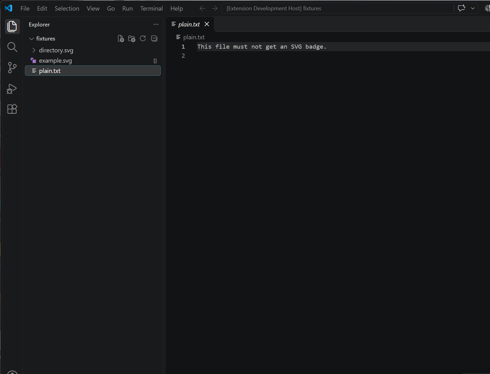
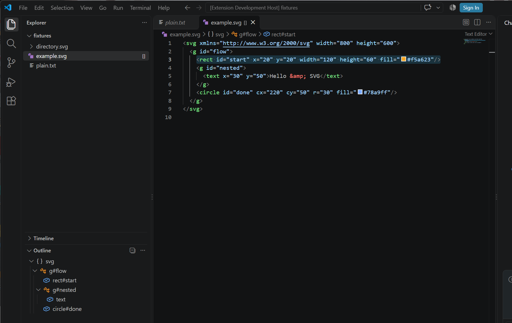

# Phase2 PART_ONE：VSCode 插件实践

## 1. 交付内容

- `src/extension.ts`：扩展入口与注册。
- `src/svgFileDecorationProvider.ts`：SVG 文件标记。
- `src/svgDocumentSymbolProvider.ts`：原生大纲与源码范围映射。
- `src/xmlParser.ts`：保留源码偏移量的轻量 XML 语法树解析器。
- `fixtures/example.svg`：包含嵌套分组、有 id 和无 id 元素的示例。
- `src/test/unit/`：解析器单元测试。
- `src/test/integration/`：真实 VSCode 扩展宿主集成测试。
- `docs/images/`：从实际扩展开发宿主采集的两张演示截图。

实现不修改 SVG 文件名或文件内容，不提供图形预览，也不进行完整 SVG 规范校验。

## 2. 安装与启动

### 2.1 开发模式（推荐验收方式）

环境要求：Node.js 20+、npm、VSCode 1.90+。

```bash
cd Phase2/PART_ONE
npm install
npm run compile
```

然后用 VSCode 打开 `Phase2/PART_ONE`，按 **F5** 选择 `Run SVG Extension`。`.vscode/launch.json` 会先编译，再启动加载本扩展的 Extension Development Host，并打开 `fixtures/` 目录。

也可以在本目录的 VSCode 集成终端运行 `npm run watch`，增量编译后重新启动扩展宿主。

### 2.2 打包安装

```bash
cd Phase2/PART_ONE
npm install
npx @vscode/vsce package
code --install-extension svg-file-outline-0.1.0.vsix
```

安装后重新加载 VSCode 窗口。扩展通过 `onStartupFinished` 激活。

### 2.3 手动验收

1. 在 Explorer 中确认 `example.svg` 右侧为 `[]`，`plain.txt` 与 `directory.svg/` 均无标记。
2. 右键 `example.svg`，选择 **Open With... → Text Editor**。
3. 打开 VSCode 原生 **Outline** 视图，确认层级为 `svg → g#flow → rect#start / g#nested / circle#done`，其中 `g#nested` 下为无 id 的 `text`。
4. 点击 `rect#start`，编辑器应定位并选中第 3 行的开始标签。
5. 把 `id="start"` 改为其他值，大纲应更新；临时删除闭合标签时，大纲可清空，但扩展宿主不得报错崩溃。

## 3. 真实运行截图

### 3.1 SVG 文件标记

`example.svg` 右侧显示 `[]`；普通文本文件与名称以 `.svg` 结尾的目录均无标记，实际文件名未改变。



### 3.2 原生大纲与源码定位

左下 Outline 展示根元素、嵌套容器和叶子；无 id 文本节点显示为 `text`。`rect#start` 对应编辑器第 3 行的高亮开始标签。



## 4. VSCode 与扩展的职责及调用过程

### 4.1 职责划分

**VSCode 负责**：

- Explorer 的文件树、文件类型信息、装饰渲染和刷新调度；
- 编辑器文档生命周期、文本变更、位置与范围模型；
- 原生 Outline 的树形展示、展开、点击导航和符号提供者调用；
- 扩展激活、API 注册表、取消令牌与注册资源释放。

**扩展负责**：

- 判断资源是否是需要标记的 SVG 文件；
- 把当前文档文本解析为保留嵌套关系和源码偏移量的语法树；
- 把语法树转换为 `DocumentSymbol`，设置标签、`range` 与 `selectionRange`；
- 对不完整 XML 做受控降级，不干扰编辑。

### 4.2 注册与反向调用

`activate()` 中通过 `vscode.window.registerFileDecorationProvider()` 注册 `SvgFileDecorationProvider`，通过 `vscode.languages.registerDocumentSymbolProvider()` 注册 `SvgDocumentSymbolProvider`。文档选择器使用 `**/*.svg`，而不是假设语言 id 一定是 `svg`；VSCode 常把 SVG 文本识别为 XML。

注册后由 VSCode 反向调用扩展：

1. Explorer 请求资源装饰时，调用 `provideFileDecoration(uri, token)`。
2. 提供者先按扩展名筛选，再用 `workspace.fs.stat()` 排除目录，最后返回 `FileDecoration('[]', 'SVG 文件')`。
3. 大纲打开、文档打开或内容变化时，VSCode 调用 `provideDocumentSymbols(document, token)`。
4. 提供者重新读取 `document.getText()`，因此每次编辑都基于最新文本生成符号，不手工维护陈旧缓存。
5. 返回符号后，VSCode 负责原生树显示；点击节点时使用 `selectionRange` 定位源码。
6. 两个注册结果都加入 `context.subscriptions`，由 VSCode 在停用时统一释放。

大纲导航会使用资源的默认编辑器。为避免 VSCode 将 `.svg` 默认交给 Image Preview，`package.json` 通过 `contributes.configurationDefaults` 将 `*.svg` 关联到内置文本编辑器 `default`。这不是运行时修改用户设置，仍可通过 **Open With... → Image Preview** 查看图像；若用户显式配置了其他编辑器关联，用户设置优先。

## 5. 文件装饰与 Decorator、Adapter 的关系和差异

### 5.1 接口与对象组合

`SvgFileDecorationProvider` 实现 VSCode 定义的 `FileDecorationProvider` 接口，返回的是 `FileDecoration` 数据对象。组合根 `activate()` 把提供者对象注册给 VSCode；Explorer 与提供者不互相直接实例化或持有界面控件，调用由宿主注入的资源 URI 驱动。

### 5.2 与经典 Decorator 的对应

两者都把附加信息与原有对象分离：这里 `[]` 是 Explorer 文件项上的附加展示信息，不改变文件模型，也不通过继承创建 `SvgExplorerItem` 子类。这与经典 Decorator“动态附加职责、避免子类爆炸”的目标相似。

但它**不是严格的经典 Decorator**：经典 Decorator 通常实现与被包装对象相同的组件接口，持有组件引用并转发请求；本实现没有包装文件、目录或 Explorer 项，也不转发文件树操作。VSCode 仍拥有原组件，扩展只按回调提供装饰元数据。因此更准确地说，它是宿主管理的 **Provider + DTO + 控制反转**，具有装饰效果而非经典对象装饰器结构。

### 5.3 与经典 Adapter 的对应

`FileDecorationProvider` 是 VSCode 预先定义的目标接口，扩展类直接实现它，这使外部调用方可以用统一接口使用本功能，与 Adapter“让对象符合目标接口”的思想有表面对应。

但本实现没有把一个已有、不兼容的接口转换成另一个接口：没有独立的既有 SVG 装饰服务，也没有被适配者（Adaptee）及方法转发。因此它不是经典 Adapter。`workspace.fs.stat()` 只是宿主文件系统服务的使用，不能仅因调用外部 API 就认定为适配器模式。

## 6. Phase1 代码复用评估

### 6.1 可复用的设计思路

Phase1 `SvgReader` 中的递归下降解析、元素/属性扫描、注释与声明跳过、实体解码和递归建树思路可复用。本实现沿用了这些思路，但重新定义了适合编辑器大纲的语法节点。

### 6.2 不能直接复用的模块及原因

| Phase1 模块 | 不能直接复用的原因 |
| --- | --- |
| `SvgReader.parseXml` / `XmlElement` | 均为模块内部私有定义；节点没有开始标签、完整元素和选择范围的字符偏移，无法生成可靠的 `DocumentSymbol.range`。 |
| `SvgReader.readString` | 目标是从文件构造 CLI `Document`，依赖 `ShapeFactory` 和领域模型；大纲需要的是当前编辑器内存文本，不应读取磁盘旧版本。 |
| `ShapeFactory` | 只装载注册的图形类型；大纲必须保留所有元素及其层级，不能因 `defs`、未知容器等未注册标签而丢失结构。 |
| `SvgReader` 的 id 处理 | 读入时会为无 id 元素自动分配 id 并产生警告；大纲必须如实显示无 id 节点，不能虚构标识。 |
| `Document` / `Shape` / `Group` | 负责 id 注册、编辑、移动、序列化等领域行为，不含源码位置，且会把扩展耦合到不需要的 CLI 状态。 |
| `Group.walk()` | 可遍历已构造的 `Shape` 树，但无法恢复被工厂跳过的 XML 节点，也没有编辑器定位信息。 |

因此本次没有直接导入 Phase1 运行模块，而是在 `xmlParser.ts` 建立独立的 `SvgSyntaxElement`，保存 `start`、`startTagEnd`、`end` 和原始 `id?`。若后续两个项目都需要同一 XML 子集，可进一步抽取一个无文件 IO、无领域依赖、包含位置信息的公共语法包，再分别适配 CLI 领域模型和 VSCode 符号模型。

## 7. 测试与验证证据

### 7.1 命令

在 `Phase2/PART_ONE` 目录运行完整测试：

```bash
npm run test:all
```

也可分别运行 `npm run test:unit` 和 `npm run test:integration`。集成测试默认下载测试用 VSCode；使用本机已有安装时可指定可执行文件：

```powershell
$env:VSCODE_EXECUTABLE_PATH = "C:\\path\\to\\Code.exe"
npm run test:integration
```

测试启动器会清除父进程可能注入的 `ELECTRON_RUN_AS_NODE`，防止 VSCode 被误作为 Node 启动。集成测试在真实扩展宿主中运行，不只是对解析函数做模拟断言。

### 7.2 最低要求覆盖矩阵

| 要求 | 验证位置与断言 |
| --- | --- |
| 嵌套分组 | `xmlParser.test.ts` 验证解析树的父子关系；`extension.test.ts` 验证完整层级为 `svg → g#flow → rect#start / g#nested / circle#done`，且 `g#nested` 包含 `text` |
| 无 id 元素 | 单元测试确认 `id` 保持为 `undefined`；集成测试确认叶子名称为 `text`，且没有虚构 `#id` 后缀 |
| 编辑更新 | 集成测试通过 `WorkspaceEdit` 将 `g#before` 攓为 `g#after`，并确认新增 `rect#changed` 与无 id 的 `text`；提供者重新读取当前文档文本 |
| 不完整 XML | 单元测试覆盖未闭合、错配、未终止属性和注释；集成测试确认提供者返回 `[]` 且不抛错，随后修复文档并确认大纲恢复 |
| 根、容器和叶子 | 集成测试分别断言根 `svg`、容器 `g#flow` / `g#nested` 和叶子 `rect#start` / `circle#done` / `text` |
| 标签与点击定位 | 集成测试检查 `标签名#id` 格式，并确认 `rect#start.selectionRange` 从第 3 行、第 4 列开始（行列均为 0 起始） |

### 7.3 其他回归验证

| 场景 | 验证位置与断言 |
| --- | --- |
| SVG 标记 | 集成测试确认 `example.svg` 的 badge 恰为 `[]` |
| 非 SVG 与目录 | 集成测试确认 `plain.txt` 和 `directory.svg/` 无装饰 |
| VSCode 注册 | 通过 `vscode.executeDocumentSymbolProvider` 验证真实注册调用链，而不只直接实例化提供者 |
| 默认文本导航 | 通过 `vscode.open` 打开 SVG，确认 `activeTextEditor` 对应该文件，避免大纲点击后进入 Image Preview |

本次验证结果：单元测试 **6 项通过**；真实扩展宿主集成测试 **6 项通过**。另有 1 个默认跳过的桌面截图场景，仅在设置 `SVG_CAPTURE_DIR` 时运行，不计入上述通过数量。

## 8. Debug：点击大纲跳转到 Image Preview

### 8.1 症状与复现

在 Outline 中点击 `rect#start` 时，VSCode 没有留在文本编辑器定位源码，而是切换到 Image Preview。回归测试通过 `vscode.open` 打开同一 SVG 资源后检查 `activeTextEditor`；修复前该值为 `undefined`，说明活动编辑器不是文本编辑器。

### 8.2 根因

大纲导航按资源的默认编辑器关联打开 URI。SVG 同时受文本编辑器和内置图像预览支持，若默认关联指向图像预览，导航即使携带符号范围，也会先进入非文本编辑器，因而无法显示源码定位。问题不在 XML 解析树或 `selectionRange` 的计算。

### 8.3 修复

在 `package.json` 中加入扩展贡献的默认编辑器关联：

```json
"contributes": {
  "configurationDefaults": {
    "workbench.editorAssociations": {
      "*.svg": "default"
    }
  }
}
```

这里 `default` 表示 VSCode 内置文本编辑器。该配置不会在运行时改写用户设置，仍可通过 **Open With... → Image Preview** 主动查看图像；用户显式配置的其他编辑器关联优先。安装或修改扩展后需重新加载窗口/重启扩展开发宿主，使新的默认关联生效。

### 8.4 回归验证

`extension.test.ts` 中的 `opens SVG symbol navigation in the text editor instead of Image Preview` 用例关闭已有编辑器，通过 `vscode.open` 打开 `example.svg`，并断言活动文本编辑器的 URI 与目标文件一致。修复前该用例失败，加入默认关联后通过；源码范围断言继续确认 `rect#start` 对应第 3 行的开始标签。

## 9. AI 协作检查与修正记录

- 检查了“只按 `.svg` 后缀标记”的建议，补充 `workspace.fs.stat()`，避免给名为 `directory.svg` 的目录加标记。
- 检查了按 `language: svg` 注册的建议，改用文件模式选择器，兼容 VSCode 将 SVG 识别为 XML 的行为。
- 没有直接复用 Phase1 私有解析器；根据大纲定位需求增加源码偏移，并保留无 id 状态。
- 将解析异常限制在提供者内部并返回空数组，避免编辑中间态使扩展宿主崩溃。
- 集成测试初次把示例缩进列号写错，依据真实失败输出修正为第 3 行第 4 列（0 起始），而不是修改源码迎合测试。
- 修复 Image Preview 跳转问题后，保留真实 VSCode 导航回归测试，防止默认编辑器关联被后续改动移除。
- 实际检查截图时发现预览页、空白窗口和大纲高度问题，最终只采用文本编辑器中原生 Outline 与源码同时可见的真实截图。
